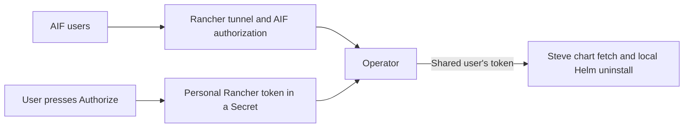
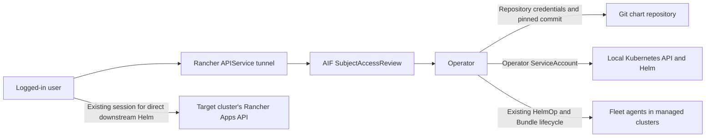

# Operation without a personal Rancher API token

This change builds on PR #383's authenticated Rancher APIService tunnel. It removes
the operator's use of `Settings.spec.rancherCatalog.tokenSecretRef`, the Steve
catalog client, and the UI's **Authorize / Rancher API Access** section.

## Identity and request flow

Before this change, one user's saved token authorized backend catalog requests
triggered by every AIF user. Expiring, revoking, or changing that user's privileges
also changed the operator's behavior.



The replacement separates authorization of an AIF request from the identity used
to execute it:



| Operation | Execution identity |
| --- | --- |
| AIF API request | Logged-in Rancher user; existing PR #383 route authorization |
| Git chart download | That ClusterRepo's `clientSecret`, or anonymous repository access |
| Direct Helm uninstall in the local cluster | Operator ServiceAccount, using the manager's Kubernetes configuration |
| Fleet-managed workload cleanup | Existing Fleet controller/agent identities |
| Direct Helm uninstall in a downstream cluster | The requesting user's current Rancher session; no saved token |

The aggregation connection Secret is still required. It is Rancher's tunnel
credential, not the retired personal catalog token. Repository deploy keys,
registry credentials, and Git publishing credentials are also still required
where their respective sources require authentication.

An AIF write permission delegates execution to a privileged controller. This
change does not introduce tenant isolation or separately authorize every resource
inside a Helm chart. Restrict AIF write access and repository administration to
trusted administrators under the current authorization model.

## Git repositories, private trust, and disconnected operation

The operator fetches the Git commit recorded in `ClusterRepo.status.commit`, using
`spec.gitRepo` and `spec.clientSecret`. If a server does not support fetching an
exact commit, it fetches `spec.gitBranch` and still requires that indexed commit
to be present. A moving branch is never substituted under an older fingerprint.
If necessary, wait for Rancher to refresh the repository index.

The fetcher accepts HTTPS and SSH remotes. Before upgrading, migrate `http://`,
`git://`, and filesystem Git sources to one of these transports.
For HTTPS Git, clear `insecureSkipTLSVerify` and configure the mirror's CA
if needed. Supply credentials through the ClusterRepo Secret. The operator waits
for Rancher to publish the first indexed commit before fetching a blueprint chart.

* HTTPS authentication uses the Secret's `username` and `password` keys, or a
  TLS client certificate in `tls.crt` and `tls.key`.
* HTTPS trust uses `spec.caBundle` (base64-encoded PEM or DER), or the credential
  Secret's `cacerts` PEM when the ClusterRepo has no CA bundle. System trust is
  used when no private CA is configured.
  When a Git repository is configured through AIF Settings, its CA Secret must
  contain one PEM certificate. AIF converts it to DER for Rancher's Git catalog
  indexer; HTTP/OCI repositories retain their PEM bundles. Multiple CA certificates
  are rejected for Git catalogs because Rancher's indexer accepts a single DER
  certificate.
* SSH requires `ssh-privatekey` and `known_hosts` in the credential Secret.
  Obtain host keys through a trusted channel. The Settings controller mirrors
  `known_hosts` from the Secret referenced by a custom repository's
  `sshKeySecretRef`, along with the private key. Existing SSH Secrets may need
  this additional key before new chart downloads succeed.

Both repository-relative archives in a Helm index and chart directories are
supported. Directories are packaged with Helm's `.helmignore` rules. Indexed
archives are checked against their SHA-256 digest when supplied, and their chart
name/version must match the request. Paths cannot escape the Git tree. No
submodules, symlinks, or external archive URLs are followed. Dependencies needed
in a disconnected environment must be included in the chart or otherwise
available through the deployment's configured internal mirrors.

These repository formats follow [Rancher's Git catalog index handling](https://github.com/rancher/rancher/blob/v2.13.1/pkg/catalogv2/git/index.go).

For an air-gapped installation, mirror the **Git repository and chart content**,
not only container images. Configure private CA/SSH trust and credentials on that
ClusterRepo. Rancher's bundled system-chart cache lives in Rancher's pod; the
operator does not read it or use Steve to download from it. A Git URL that points
outside the disconnected network must be replaced with a reachable mirror.

Git fetching is implemented in Go; this change adds no container image or Git
executable dependency. Existing chart delivery through Fleet Bundles is retained.
Fetching is shallow but transfers a repository snapshot, so large repositories
need sufficient network bandwidth and temporary disk capacity. Scratch space is
an `emptyDir`, mounted at `/tmp`, with a default size limit of `1Gi`; configure
`manager.temporaryStorageSizeLimit` for larger mirrors. Kubernetes may evict a
pod that exceeds its storage limit. Temporary repositories are removed after each
fetch. The scratch volume is discarded when the pod is replaced; a container
restart alone retains that volume.

Fetches have a three-minute deadline. Indexes are limited to 16 MiB, compressed
chart archives to 4 MiB, and unpacked chart data to 32 MiB. For directory charts,
the size bound applies before `.helmignore` filtering. Repository scans are bounded
to 100,000 entries. Existing Fleet Bundle payload limits still apply.
Use a smaller chart mirror or an HTTP/OCI chart repository when these limits do
not fit the source.

## Helm cleanup and permissions

For local direct-Helm workloads, the UI deletes the AIWorkload and lets its
finalizer perform cleanup. The executor checks the stored Helm release's
namespace, name, and chart name; waits for pending Helm operations; and checks its
own resource permissions before starting deletion. It honors Helm keep policies
and delete hooks. No personal-token fallback exists.

Release history and a persistent cleanup marker are retained until hooks and
resource cleanup succeed. Permission failures, timeouts, and failed hooks keep
the AIWorkload finalizer and expose a condition. Reconciliation retries cleanup
after restarts. Do not remove the finalizer as a substitute for completing cleanup.

The operator can run two local Helm uninstalls concurrently. A third AIWorkload
worker can continue processing Fleet updates and other reconciles while Helm
waits for foreground deletion and hooks.

The following examples compare default chart manifests with the shipped
permissions for **Apps installed with direct Helm on the local cluster**.
Blueprint installations use Fleet Bundle or GitOps on every target. Chart
versions and values can change the permissions a direct App needs.

| Chart | Resources relevant to uninstall | Default local cleanup |
| --- | --- | --- |
| Ollama 1.55.0 and Qdrant 1.19.0 | Standard namespaced workloads, Services and ServiceAccounts | Covered |
| OpenSearch 3.3.2 | Also renders a PodDisruptionBudget | Covered |
| Open WebUI 8.19.1 | Also renders cert-manager Certificates and Issuers | Covered |
| NVIDIA GPU Operator v25.10.1 | ClusterPolicy, ClusterRoles, ClusterRoleBindings and delete hooks | Requires chart-specific permissions or administrator uninstall |

The role also grants `get` and `delete` on HorizontalPodAutoscalers and
ServiceMonitors. If preflight reports a missing permission, an administrator
can grant the listed verbs or uninstall the release from Rancher **Apps >
Installed Apps** on the local cluster. After the release disappears, the
operator completes the pending AIWorkload deletion.

For example, a delete-hook Job can use this additional **Role in its target
namespace**, bound to the operator's ServiceAccount.

```yaml
apiVersion: rbac.authorization.k8s.io/v1
kind: Role
metadata:
  name: aif-helm-delete-hooks
  namespace: my-workload
rules:
  - apiGroups: [batch]
    resources: [jobs]
    verbs: [get, list, watch, create, delete]
---
apiVersion: rbac.authorization.k8s.io/v1
kind: RoleBinding
metadata:
  name: aif-helm-delete-hooks
  namespace: my-workload
subjects:
  - kind: ServiceAccount
    name: aif-operator
    namespace: aif-operator
roleRef:
  apiGroup: rbac.authorization.k8s.io
  kind: Role
  name: aif-helm-delete-hooks
```

Adjust the ServiceAccount name/namespace for the release. Grant only the kinds
needed by the chart; the hook's own ServiceAccount permissions are separate.

For direct Helm in downstream clusters, the UI starts uninstall using the caller's
session, waits for the App to disappear, then confirms cleanup to the operator.
The confirmation binds the workload UID, cluster, namespace, and release. It is
the caller's acknowledgement, not independent proof from the target cluster.
Failures retain the CR. Direct `kubectl delete` retains the finalizer until
external cleanup is acknowledged; it never deletes a same-named local release.
Use Fleet-managed workloads for unattended downstream lifecycle management.

### Recover a terminating downstream direct-Helm workload

Run the following Bash block while the operator is running, including before
retiring the management namespace or operator. Set the two kubeconfig contexts
and the Rancher cluster ID for the selected downstream context. The block reads
the release identity from the terminating AIWorkload, uninstalls it on that
downstream cluster and checks its Helm release Secrets before acknowledging cleanup.

```bash
(
  set -euo pipefail
  management_context=local
  downstream_context=my-downstream-context
  downstream_id=c-m-example
  workload_namespace=my-workloads
  workload=my-workload

  fields=$(kubectl --context "$management_context" -n "$workload_namespace" get aiworkload "$workload" -o json |
    jq -er --arg cluster "$downstream_id" '
      select(.metadata.deletionTimestamp and (.spec.deployStrategy // "Helm") == "Helm"
             and $cluster != "local" and .spec.targetClusters == [$cluster]) |
      [.metadata.uid, .spec.targetNamespace, .spec.source.app.release, .metadata.resourceVersion] |
      select(all(.[]; type == "string" and length > 0)) | @tsv')
  IFS=$'\t' read -r uid namespace release version <<< "$fields"
  helm --kube-context "$downstream_context" -n "$namespace" uninstall "$release" --wait --ignore-not-found
  history=$(kubectl --context "$downstream_context" -n "$namespace" get secrets -l "owner=helm,name=$release" -o name)
  test -z "$history"
  kubectl --context "$management_context" -n "$workload_namespace" annotate aiworkload "$workload" \
    --resource-version="$version" --overwrite \
    "ai-factory.suse.com/external-helm-cleanup=$uid/$downstream_id/$namespace/$release"
)
```

The resource-version check binds the update to the workload you inspected. On
a conflict, confirm the contexts and run the block again. The operator removes
the finalizer after checking the acknowledgment against the current target.

## Upgrade and retirement of old tokens

1. Back up Settings and identify the old token's owner/name before upgrading.
   A UI-created Secret normally has the annotation
   `ai-factory.suse.com/token-name`. Treat exports and Helm release history as
   sensitive when the old token was supplied inline.
2. Check Git mirrors, private trust (including SSH `known_hosts`), temporary
   storage, and chart-specific uninstall RBAC. Finish ongoing Helm operations.
3. Upgrade the operator, chart/CRDs, and UI together. Refresh the browser so it
   loads the UI without the Authorize section. Verify the Rancher aggregation
   tunnel and both a chart installation and an uninstall.
4. Revoke the retired personal token in Rancher using its owner or an authorized
   administrator. **Deleting a Kubernetes Secret does not revoke a Rancher token.**
   Do not revoke credentials shared with unrelated applications without first
   separating those uses.
5. Remove obsolete token Secrets, Settings references, and `rancherCatalog`
   values after confirming they are no longer needed. Historical Helm revisions
   may retain an inline token; revocation is essential.

The CRD retains `rancherCatalog` as deprecated, ignored data for compatibility;
the operator neither reads its Secrets nor sends its token. Cached older
credential-check requests return `skipped`. The chart ignores legacy
`rancherCatalog` values and no longer creates the catalog-token Secret. Helm may
remove a formerly chart-owned Secret on upgrade; it does not remove unrelated
user-created Secrets. An empty `spec` map prevents Helm 3's three-way merge from
removing the entire Settings spec when the retired token was its only chart-owned
setting.

Rollback to the old operator restores its personal-token requirement. A revoked
token cannot be restored by Helm rollback. Plan rollback with repository access
and credentials appropriate to that older version; do not postpone revocation
indefinitely to preserve rollback convenience.

## Release validation

The [PR #387 disconnected-lab report](validation/pr-387-airgap.md) records a real
upgrade from 2.4.0, private Git deployment, token revocation, cleanup failures and
recovery, and repeatable validation steps. Its tested configuration and remaining
coverage are stated explicitly.

Automated coverage exercises private HTTPS Git, commit pinning, credential
rotation, archive validation, Helm permissions and cleanup retries, external
cleanup confirmations, token-free Settings behavior, and Helm upgrade merging.
Before production rollout, also validate on a real supported Rancher/Fleet cluster:

* Upgrade an existing installation with UI-managed Settings and existing releases.
* Install from the actual disconnected Git mirror with public egress denied.
* Delete local releases with the supported charts' real hooks and RBAC.
* Delete Fleet-managed and direct-Helm downstream workloads, including failures
  and an operator restart during cleanup.
* Confirm repository credential rotation, user permission denials, and token
  revocation do not interrupt the service-identity operations.
